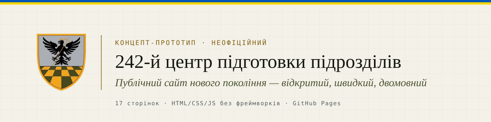
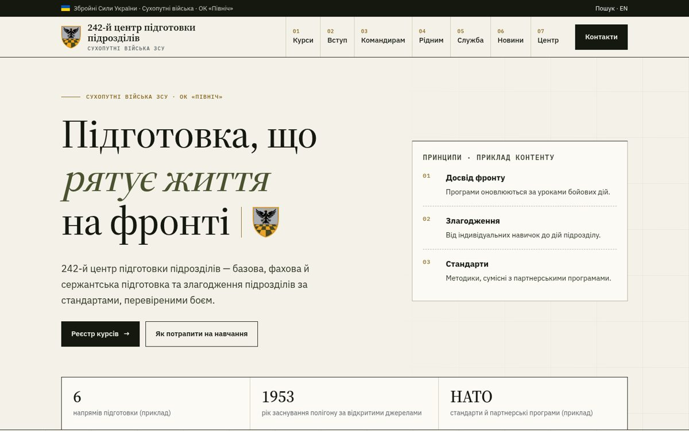
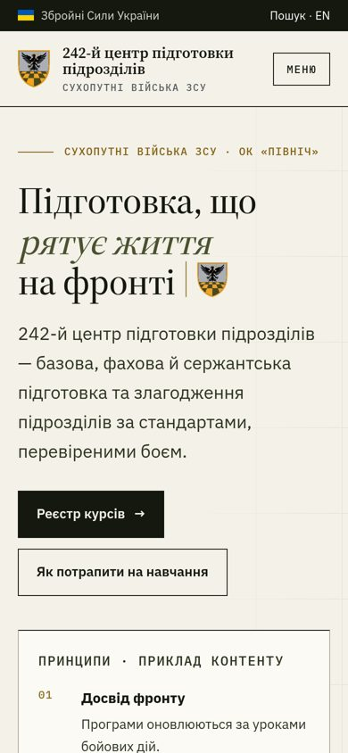
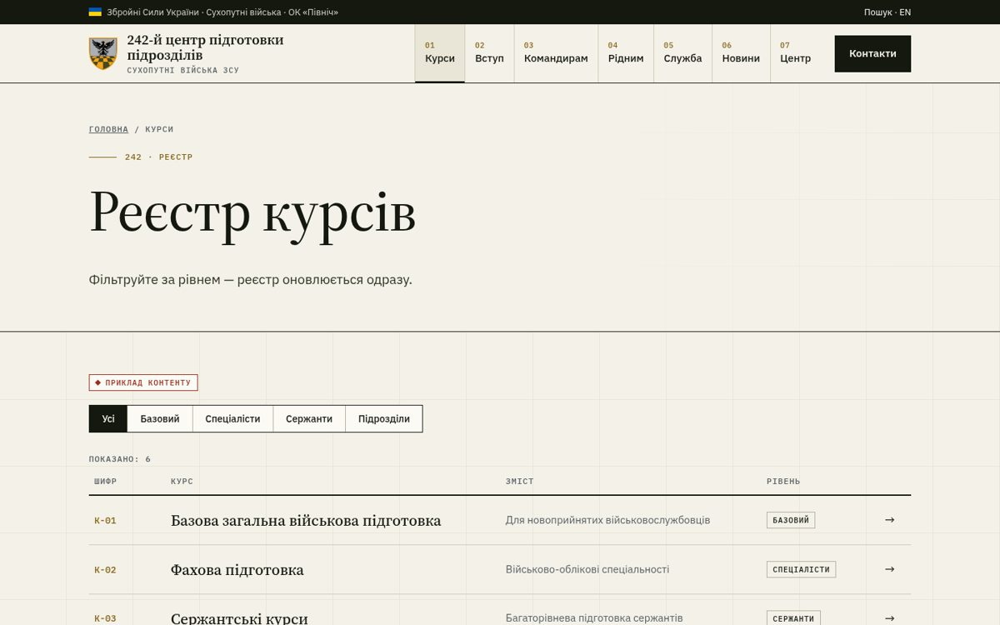
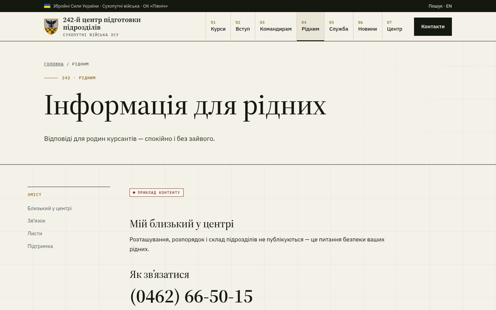

<div align="center">



### Концепт нового публічного сайту 242-го навчального центра

**[▶ Відкрити живе демо](https://aleks-army.github.io/242.mil.gov.ua/)** &nbsp;·&nbsp;
[Курси](https://aleks-army.github.io/242.mil.gov.ua/courses.html) &nbsp;·&nbsp;
[Рідним](https://aleks-army.github.io/242.mil.gov.ua/families.html) &nbsp;·&nbsp;
[Командирам](https://aleks-army.github.io/242.mil.gov.ua/commanders.html) &nbsp;·&nbsp;
[English](https://aleks-army.github.io/242.mil.gov.ua/en.html)


</div>

> [!IMPORTANT]
> **Неофіційний концепт-прототип.** Це не офіційний сайт 242-го навчального центра, Сухопутних військ чи Міністерства оборони України, і він не схвалений ними чи НАТО. Офіційний сайт: [242.mil.gov.ua](https://242.mil.gov.ua/). Тексти, цифри, курси, новини й вакансії в демо — **приклад контенту**.

**English in brief.** An unofficial, clickable concept for a modern public website of Ukraine's 242nd training centre: mobile-first, fast, bilingual and built around four audiences — trainees, families, unit commanders and candidates. Static HTML/CSS/JS on GitHub Pages. Not affiliated with or endorsed by the Armed Forces of Ukraine, the Ministry of Defence or NATO. → [Live demo](https://aleks-army.github.io/242.mil.gov.ua/)

---

## Чому цей проєкт

Сайт навчального центру — перше, що бачать кандидат, мама курсанта, командир частини чи іноземний партнер. Концепт показує, яким він може бути:

| | Сьогодні (типово) | У концепті |
|---|---|---|
| **Відвідувачі** | одна внутрішня платформа для всіх | окремі шляхи для 4 аудиторій |
| **Телефон** | важка головна сторінка | mobile-first, легка верстка |
| **Партнери** | мало англійською | окремий англійський розділ |
| **Безпека** | службове поруч із публічним | навчальна платформа — окремий захищений розділ |

## Як це виглядає

<p align="center">
  
  &nbsp;
  
</p>

<details>
<summary><b>Ще екрани</b> — реєстр курсів, сторінка для рідних</summary>
<br>
 
</details>

<sub>Знімки зроблено з живого демо 7 листопада 2026 року.</sub>

## Для кого

- 🎖 **Військовослужбовцям на навчанні** — [реєстр курсів](https://aleks-army.github.io/242.mil.gov.ua/courses.html), [картка курсу](https://aleks-army.github.io/242.mil.gov.ua/course.html), [навчальна платформа](https://aleks-army.github.io/242.mil.gov.ua/platform.html)
- 👪 **Рідним** — [що взяти, як зв’язатися, відповіді](https://aleks-army.github.io/242.mil.gov.ua/families.html), [питання](https://aleks-army.github.io/242.mil.gov.ua/faq.html)
- 🧭 **Командирам частин** — [як направити підрозділ](https://aleks-army.github.io/242.mil.gov.ua/commanders.html)
- ✍️ **Кандидатам** — [як потрапити на навчання](https://aleks-army.github.io/242.mil.gov.ua/join.html), [служба в центрі](https://aleks-army.github.io/242.mil.gov.ua/vacancies.html)
- 🤝 **Партнерам і медіа** — [English](https://aleks-army.github.io/242.mil.gov.ua/en.html), [медіа-кіт](https://aleks-army.github.io/242.mil.gov.ua/media.html), [новини](https://aleks-army.github.io/242.mil.gov.ua/news.html)

## Що вже працює в демо

- ✅ 17 клікабельних сторінок і фірмова сторінка 404
- ✅ Адаптивне меню для телефона
- ✅ Фільтр у реєстрі курсів
- ✅ Демо-форма відгуку на вакансію — **нічого не надсилає і не зберігає**
- ✅ Демо-пошук (інтерфейс, без серверної частини)
- ✅ Справжня емблема центру з офіційного сайту, однакова в шапці та іконці вкладки
- ✅ Локальні шрифти, жодних сторонніх трекерів і CDN

**Цілі, а не сертифікація:** доступність за WCAG 2.2 AA, швидке завантаження на мобільному інтернеті. Формального аудиту доступності не проводилося.

## Стек

Чистий **HTML + CSS + vanilla JavaScript**, без збірки й залежностей. Хостинг — **GitHub Pages** з гілки `main`.

```text
.
├── index.html            головна
├── courses.html, course.html
├── families.html, commanders.html, join.html, vacancies.html
├── about.html, news.html, news-article.html, media.html
├── faq.html, contacts.html, search.html, platform.html, en.html
├── 404.html
├── assets/
│   ├── style.css         уся дизайн-система
│   ├── app.js            меню, фільтр курсів, демо-форма
│   ├── fonts/            локальні шрифти (woff2)
│   └── emblem.*, favicon-*
└── .github/assets/       зображення для README (на сайт не впливають)
```

## Запуск локально

```bash
git clone https://github.com/Aleks-Army/242.mil.gov.ua.git
cd 242.mil.gov.ua
python3 -m http.server 8000
# відкрийте http://localhost:8000
```

## Дорожня карта (пропозиція)

- [ ] Повний англійський розділ (5 сторінок для партнерів і візитів)
- [ ] Реальний контент, погоджений пресслужбою
- [ ] Перенесення навчальної платформи на окремий захищений піддомен
- [ ] Аудит доступності та продуктивності (Lighthouse, ручна перевірка зчитувачем екрана)
- [ ] Аналітика без персональних даних
- [ ] Векторна (SVG) версія емблеми від офіційного джерела

## Долучитися

Пропозиції щодо дизайну, текстів і доступності вітаються — див. [CONTRIBUTING.md](CONTRIBUTING.md). Будь ласка, **не додавайте** персональні дані військовослужбовців, службову чи чутливу інформацію.

## Права

Емблема та назва належать 242-му навчальному центру ЗСУ і використані лише для ілюстрації концепту. Ліцензію на код поки не визначено.
